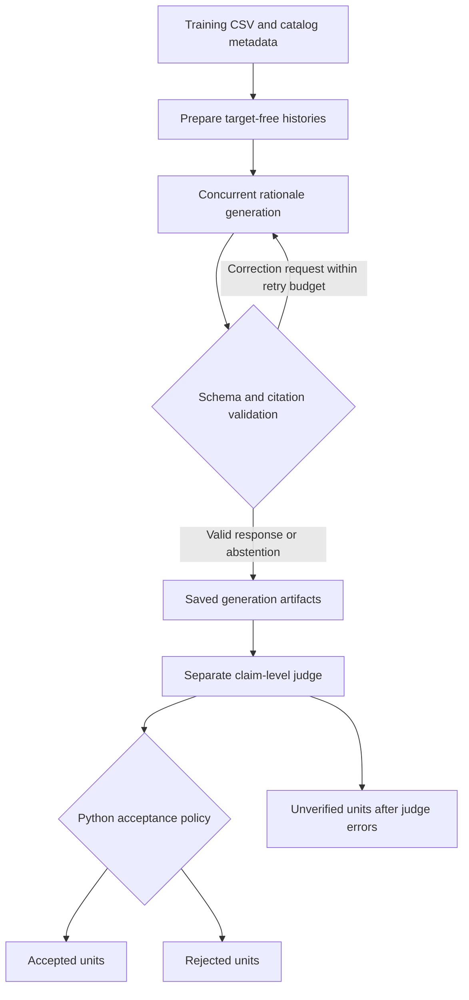

# External reasoning generation: implementation and run guide

Updated: 28 October 2026. Scope: the implementation under `external_rational/` in the R3 repository.

## Purpose and workflow

This pipeline creates reusable, evidence-grounded reasoning units for sequential recommendation from training-history prefixes. Each unit separates **evidence**, **interpretation**, and **recommendation**. Generation and judging run independently: generate the dataset first, inspect its completion, then judge the saved units.

The default inference service is `http://sodag:8000/v1`, serving `Qwen/Qwen3.5-9B`. Both stages use the Python standard library and send requests to an existing vLLM server; the scripts do not start vLLM or load the model locally.



This produces an external reasoning bank. It does not train R3, modify a recommendation checkpoint, or establish a recommendation-performance improvement.

## Implementation map

| File under `external_rational/` | Responsibility |
|---|---|
| `run_full_dataset.py` | Prepare and generate the full dataset; resume generation; never invoke judging. |
| `judge_full_dataset.py` | Check generation completion and judge saved units independently. |
| `pipeline.py` | Read CSV histories, clean metadata, build prompts, call vLLM, validate generation, preserve attempts, and export structured reports. |
| `scored_verification.py` | Build claims and diagnostics, validate judge output, apply score caps and acceptance rules, and export judge reports. |
| `rationale_progress.py` | Concurrent workers, completion-order progress bars, and runtime estimates. |
| `prompts/generator_system.txt`, `prompts/generator_user.txt` | Generation instructions and response schema. |
| `prompts/scored_verifier_system.txt`, `prompts/scored_verifier_user.txt` | Claim-level judging instructions and judgment schema. |
| `prompts/verifier_system.txt`, `prompts/verifier_user.txt` | Earlier six-check verifier, available through `pipeline.py verifier`; the full-dataset judge uses the scored verifier instead. |

## Input preparation and full-dataset coverage

Default Toys sources:

- Training CSV: `data/Toys_and_Games/train/Toys_and_Games_5_2017-1-2018-11.csv`.
- Catalog metadata: `data/Toys_and_Games/meta_Toys_and_Games.json`.

`parse_history()` checks that item IDs, ASINs, titles, ratings, and timestamps are aligned lists. Preparation rejects unsorted timestamps and histories extending past their training-row outcome. It keeps the latest `--max-history` events and retains their original sequence positions and citation IDs.

`build_inputs()` supports two selection modes:

| Option | Meaning |
|---|---|
| `--selection all-prefixes` | Select every eligible training row, including several prefixes from the same user. This is the full-run default. |
| `--selection one-per-user` | Select one seeded random eligible prefix per user, as in the original pilot. |
| `--limit 0` | No cap under the selected mode. |
| `--limit N` | Select at most N eligible histories. In all-prefixes mode, these are the first N eligible CSV rows. |
| `--min-history 1` | Include all nonempty histories, including sparse histories. |
| `--max-history 20` | Supply the latest 20 interactions per selected row, not necessarily the user's entire history. |
| `--seed 42` | Default preparation/API seed. GPU inference is not guaranteed to be bit-for-bit deterministic. |

The existing full Toys preparation manifest records **53,898 selected histories**, **10,167 eligible users**, and **6,248 distinct history ASINs**, all matched to catalog metadata. These are preparation counts, not completed-generation or accepted-rationale counts.

Histories are enriched with available category, brand, feature, and description fields. The original training title takes precedence over the catalog title. HTML is removed and metadata lengths are bounded. Missing fields remain missing; popularity ranks and `also_buy`/`also_view` links are excluded.

The next-item target and its title, rating, and timestamp are saved separately in `targets_audit_only.jsonl`. The raw user ID is not sent to either model stage. Provenance retains a user hash, source-row index, evidence cutoff timestamp, and history hash. Static metadata availability at the original interaction date is not established.

## Saved reasoning format

A generation response contains `status`, a list of zero to three `rationales`, and a comparison of the supported hypotheses. `insufficient_evidence` with an empty list is a valid abstention.

Each rationale contains these three reasoning components:

1. **Evidence:** factual statements about observed items, with structured citations.
2. **Interpretation:** a qualified preference hypothesis connected to those facts.
3. **Recommendation:** possible next-item attributes or directions supported by the interpretation.

Example of a rationale unit:

```json
{
  "rationale_id": "R1",
  "facet": "Munchkin bath toys",
  "relation": "continuity",
  "applicability": "Multiple observed Munchkin bath-toy products",
  "evidence": [
    {
      "event_ids": ["H1", "H4"],
      "metadata_fields": ["brand"],
      "statement": "Munchkin Ocean Squirts Bath Toy and Munchkin Wind Up Swimming Penguin Bath Toy both list Munchkin as their brand.",
      "evidence_quotes": [
        {"event_id": "H1", "field": "brand", "quote": "Munchkin"},
        {"event_id": "H4", "field": "brand", "quote": "Munchkin"}
      ]
    }
  ],
  "interpretation": "Repeated interactions with distinct Munchkin bath toys may suggest continuity of interest in this brand and category.",
  "recommendation": "Consider other Munchkin bath toys with similar play functions.",
  "limitations": ["A short history does not establish an exclusive brand preference"],
  "downweight_when": ["Recent Munchkin bath-toy ratings are low"]
}
```

`H1` and `H4` are internal event references, not item names. Readable reasoning uses supplied item titles; event labels belong in citation fields. The prompt keeps “However…” caveats and closing counterarguments out of the reasoning components. Limitations and downweight conditions are stored separately. Appropriate qualification such as “may suggest” can remain within the interpretation.

Relations are `continuity`, `refinement`, `transition`, `complementarity`, or `other`. The prompts prohibit invented demographics, motivation, compatibility, and missing product properties.

The current generator requests this structured format directly. Legacy responses with `observations`, `continuation`, and `text` remain readable: exports map observations to evidence and continuation to recommendation. Formatting an existing response does not regenerate or independently revalidate its reasoning.

Style is instructed by the prompts. The generation validator enforces schema and source-reference/quotation checks; it does not guarantee perfect stylistic compliance or semantic entailment. Earlier pilots used additional recorded model correction requests for residual style violations.

## Generation implementation

`run_full_dataset.py` calls preparation, then `pipeline.run_stage()` with the generator stage. Requests use `/chat/completions`, JSON-object output, and `enable_thinking=False`. The generated rationale is explicit output, not a private reasoning trace.

For each history, validation checks required fields, allowed relation values, cited event IDs, metadata-field existence, and quotation coverage for every cited event/field pair. Quotation matching normalizes case and whitespace. These checks establish source-text existence, not whether the evidence entails the surrounding claim.

Schema/reference errors trigger correction feedback containing the specific errors. By default, two retries allow up to three API attempts per history. Failed records retain errors and raw responses. Repeated runs cache compatible successful records and retry failed or missing ones, advancing seeds and retaining prior attempt history.

## Independent scored verification

`judge_full_dataset.py` defaults to requiring valid generation records for all prepared histories. To judge successful saved generations when other histories exhausted their retries, pass `--allow-partial`. Failed or missing histories are excluded and recorded in `source_exclusions.json` and the summary. A valid abstention counts as completed generation but creates no judge jobs. If no valid rationale units exist and there are exclusions, partial judging fails rather than reporting success. Keep generation files fixed during judging so the frozen list of units remains stable.

The judge receives the source history, one rationale, a claim list, and deterministic diagnostics. Targets, earlier judge decisions, and assistant audit decisions are withheld. Evidence statements become observation claims; interpretation and recommendation are assessed separately. A legacy standalone text is also assessed when present.

Every observation requires a check for each cited event. Supporting checks require source quotations. The implementation validates those quotations, claim coverage, scores, and event references before applying policy.

The judge assigns nine integer scores from 1 to 5:

- factuality;
- evidence selection;
- signal strength;
- intent translation;
- causal logic;
- recommendation fit;
- temporal reasoning;
- confidence calibration;
- task fulfillment.

Python makes the final decision. Acceptance requires **factuality >= 4**, **evidence selection >= 4**, and **causal logic >= 4**, with no unsupported/contradictory central claim and no flagged violation. High scores elsewhere cannot override a failed claim. Violations can cap effective scores; raw and effective scores are both saved.

Current **policy v3** treats supplied history order as authoritative chronological order. Earlier/later and sequence-based transitions may use that order even when timestamps tie or are absent. Refinement/transition still requires two distinct cited products, and item attributes must support the claimed change. List order alone does not establish growing preference, causality, or an elapsed duration. The CSV preparation checks still require the timestamp columns described above.

Judge schema/quotation failures are retried. Exhausted judge errors are **unverified**, not substantive rejections. The default judge is the same Qwen3.5-9B model as the generator, so its errors can correlate with generation errors. Accepted means passed this automated grounding screen.

## Configuration defaults

| Setting | Generation | Judge |
|---|---|---|
| Server | `http://sodag:8000/v1` | Same default; independently configurable |
| Model | `Qwen/Qwen3.5-9B` | Same default; independently configurable |
| Workers | 2 | 2 |
| Temperature | 0.6 | 0.0 |
| `top_p` | 0.8 | 0.8 |
| Maximum output tokens | 4,096 | 6,000 |
| Timeout per API attempt | 240 seconds | 240 seconds |
| Retries after first attempt | 2 | 2 |
| API seed | 42 | 42 |

`VLLM_API_KEY` is used if set and is not saved in request artifacts. Requests to the internal vLLM service bypass environment HTTP proxies.

## Run instructions

The following commands are instructions to execute; creating this document does not launch a full generation or verification job.

### Set paths

Run these shell assignments before the following commands:

```bash
rationale_project=/common/home/users/m/mk.ngohuu.2024/research/R3
rationale_run="$rationale_project/external_rational/results/toys_full_qwen35_9b"
```

The default data files are resolved from the script location, so commands using these absolute paths can be run from another working directory.

### Prepare inputs only

```bash
python -u "$rationale_project/external_rational/run_full_dataset.py" \
  --output-dir "$rationale_run" \
  --selection all-prefixes --limit 0 \
  --min-history 1 --max-history 20 \
  --prepare-only
```

Use a new run root for a new experiment. To reuse the existing prepared run after a code-only update, add `--resume` while keeping its preparation settings unchanged.

### Generate the full dataset

```bash
python -u "$rationale_project/external_rational/run_full_dataset.py" \
  --output-dir "$rationale_run" \
  --base-url http://sodag:8000/v1 \
  --model Qwen/Qwen3.5-9B \
  --selection all-prefixes --limit 0 \
  --min-history 1 --max-history 20 \
  --concurrency 2
```

This script performs preparation and generation only. It never starts the judge.

### Continue an existing generation run

```bash
python -u "$rationale_project/external_rational/run_full_dataset.py" \
  --output-dir "$rationale_run" \
  --base-url http://sodag:8000/v1 \
  --model Qwen/Qwen3.5-9B \
  --selection all-prefixes --limit 0 \
  --min-history 1 --max-history 20 \
  --concurrency 2 --resume
```

Successful records remain unchanged. Failed/missing records are retried, and failed attempts retain their history and per-attempt configuration hashes. Config revisions are archived in `preparation_history/` and `generation/generations/config_history/`.

`--resume` explicitly permits a changed pipeline code hash. It does not permit changed prompts, model, decoding parameters, input data, or selection settings. Use a new run directory for those changes. A code-compatible resume preserves existing results; it does not rejudge them under a new semantic policy.

### Judge after generation completes

```bash
python -u "$rationale_project/external_rational/judge_full_dataset.py" \
  --input-dir "$rationale_run/generation" \
  --output-dir "$rationale_run/verification" \
  --base-url http://sodag:8000/v1 \
  --model Qwen/Qwen3.5-9B \
  --concurrency 2
```

If generation attempted the full dataset but some histories failed validation,
append `--allow-partial` to the judge command above. This judges only the valid
saved rationale units; it does not repair or accept failed generations. Inspect
`verification/source_exclusions.json` for excluded histories. Progress counts
rationale units, while exclusion counts refer to histories. If generation is
retried later and the valid subset changes, choose a new verification output
directory instead of reusing the old frozen job list.

The judge reads saved generations and does not modify them. Both model and server can differ from generation. Repeating the same judge command caches valid judgments and retries errors. The judge does not expose the generator's code-only `--resume` exception: changed judge code, prompts, policy, or inference configuration requires a new verification output directory.

### Optional background execution and logs

For example, to continue generation in the background:

```bash
mkdir -p "$rationale_project/run_logs"
nohup python -u "$rationale_project/external_rational/run_full_dataset.py" \
  --output-dir "$rationale_run" --resume --concurrency 2 \
  > "$rationale_project/run_logs/toys_reasoning_generation.log" 2>&1 < /dev/null &
```

This example uses the default model and decoding settings; retain any explicit overrides from the original run. Use only one writer per generation directory. Start judging separately after generation is complete.

```bash
tail -f "$rationale_project/run_logs/toys_reasoning_generation.log"
```

### CLI reference and tests

```bash
python "$rationale_project/external_rational/run_full_dataset.py" --help
python "$rationale_project/external_rational/judge_full_dataset.py" --help
cd "$rationale_project"
PYTHONDONTWRITEBYTECODE=1 python -m unittest discover \
  -s external_rational -p 'test_*.py'
```

## Concurrent workers and progress estimates

Each script has its own `--concurrency`. `ThreadPoolExecutor` runs API work concurrently, and finished results are processed in completion order. One slow request cannot hide other completed requests. Increasing workers affects load on the existing vLLM server; it does not start more model servers.

The progress bar includes completed/total, percentage, elapsed stage time, ETA, estimated total stage runtime, cached records, and errors. The estimate is:

```text
ETA ≈ unfinished jobs × mean observed noncached job duration / worker count
estimated total stage runtime ≈ elapsed stage time + ETA
```

Observed job duration includes retries, backoff, and record handling. Cached/skipped jobs do not seed the estimate. ETA is unavailable until the first noncached job completes and remains approximate, especially early in the run or when retry frequency changes. Preparation, metadata scanning, and final report writing are outside this estimate.

Interactive output refreshes in place about once per second. Redirected logs receive plain progress lines about every 10 seconds plus initial/final updates. Progress uses stderr; `2>&1` captures it with stdout. A completed generation unit is a history; a completed judge unit is one rationale, so stage totals can differ.

## Saved artifacts and how to read results

```text
toys_full_qwen35_9b/
  preparation.json
  preparation_history/
  generation/
    data_manifest.json
    inputs.jsonl
    targets_audit_only.jsonl
    provenance.jsonl
    metadata_subset.jsonl
    generations/
      config.json
      config_history/
      000000.json
      ...
    all_rationales_review.jsonl
    accepted_rationales.jsonl
    summary.json
    review.md
  verification/
    config.json
    jobs.jsonl
    source_exclusions.json
    judgments/
      000000.json
      ...
    all_rationales_review.jsonl
    accepted_rationales.jsonl
    summary.json
    review.md
```

Use `generation/all_rationales_review.jsonl` for generated structured units and `verification/accepted_rationales.jsonl` for model-screened units. Read `verification/summary.json` and `verification/review.md` for final judge outcomes.

The generation report does not import the separate scored judgments. Its `verification_missing`, `unverified`, or `complete: false` can reflect that separation even after the independent judge has finished. Its acceptance rate is not the scored judge's acceptance rate. An empty generation-stage accepted file is therefore not evidence that every rationale was rejected.

Raw generation status `ok` means the response passed generation checks; it does not mean accepted by the judge. A valid abstention has no rationale units to judge. Judge status `error` means no valid judgment was obtained. Scripts return a nonzero status when API/schema attempts are exhausted, while retaining successful work for resuming. All-abstention datasets can produce an empty verification result without errors.

## Troubleshooting

| Symptom | Meaning and next step |
|---|---|
| Preparation or stage configuration changed | For generation code-only changes, use `--resume`. For changed data/prompts/model/decoding, use a new run root. |
| “Finish generation before judging” | Resume generation, or add `--allow-partial` to judge valid saved units and log excluded histories. |
| “quote not found” | A generated quotation does not match its referenced source field after normalization. Inspect saved attempts; retries may correct it. |
| “Incomplete response: length” | The output token limit was exhausted. To change that decoding limit, use a new generation run or judge output directory as appropriate. |
| Judge errors remain unverified | Repeat the same judge command to retry. Do not treat these units as substantive rejections. |
| Progress starts without ETA | Wait for a noncached job to finish. Cached results are excluded from throughput estimation. |
| Generator reports no accepted units | Inspect the separate verification output, not the generator's acceptance count. |

## Historical pilot context

The saved continuous-flow pilot produced 16 units from 12 Toys histories. Its scored run recorded 8 accepted, 4 rejected, and 4 unverified units. That run used **policy v2**, which required distinct timestamps for refinement/transition. The current policy is **v3**, which trusts supplied history order. The old counts and decisions remain historical artifacts; they have not been recomputed under v3.

Accepted units are candidates for downstream experiments. The pilot and full-run preparation do not establish predictive utility, cross-user transfer, or a benefit from latent reasoning. Preserve donor-user and time provenance when designing later retrieval experiments.
